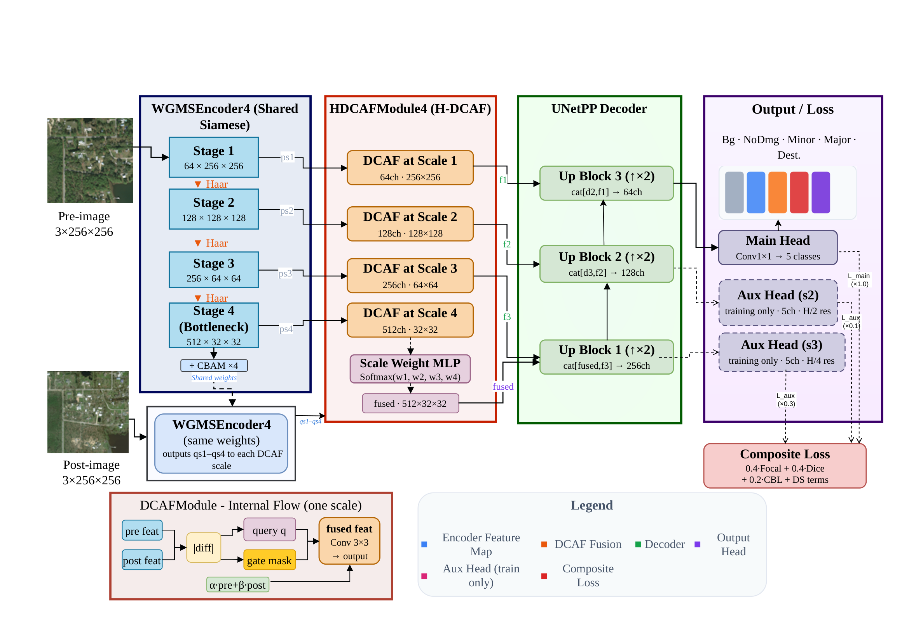
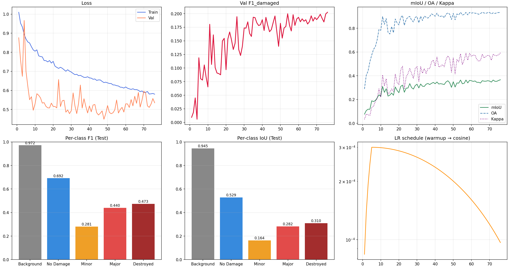
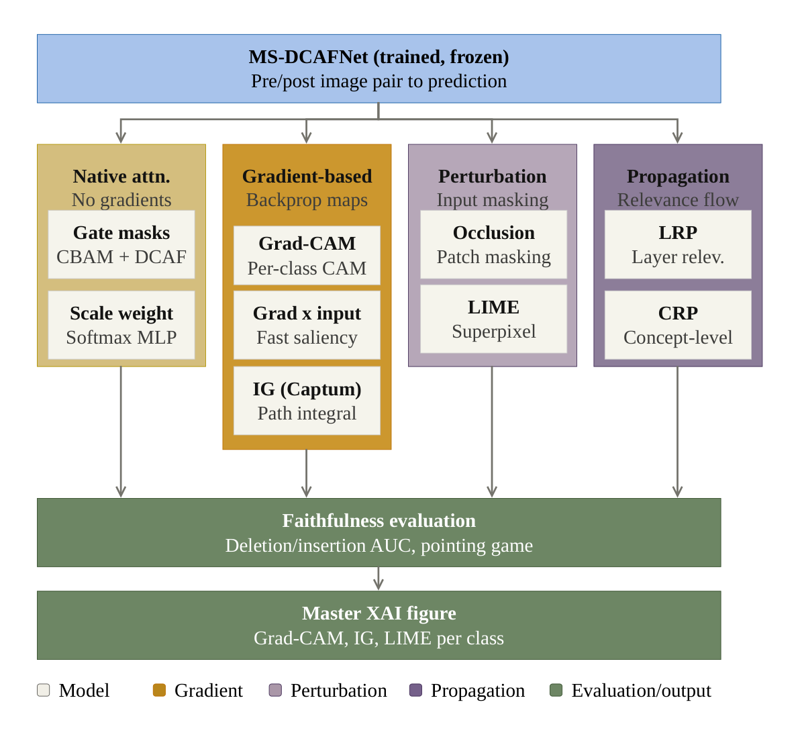
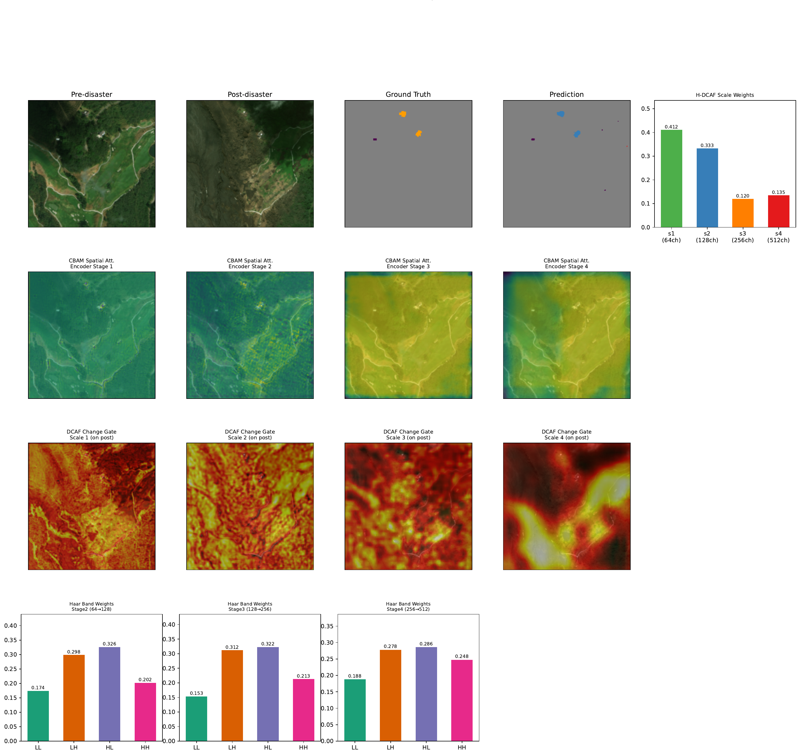
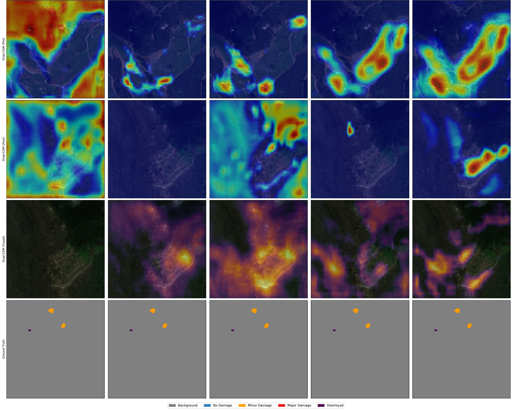
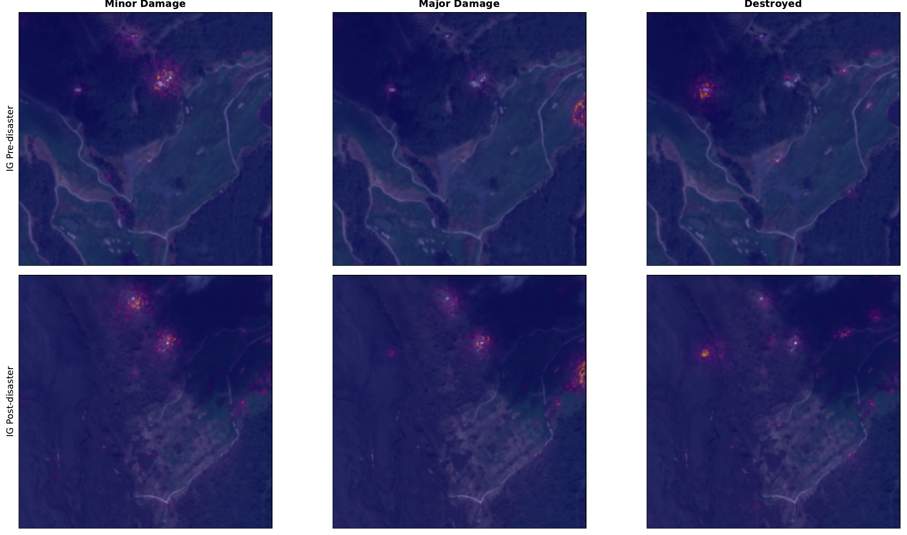
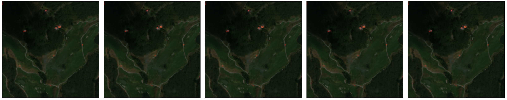
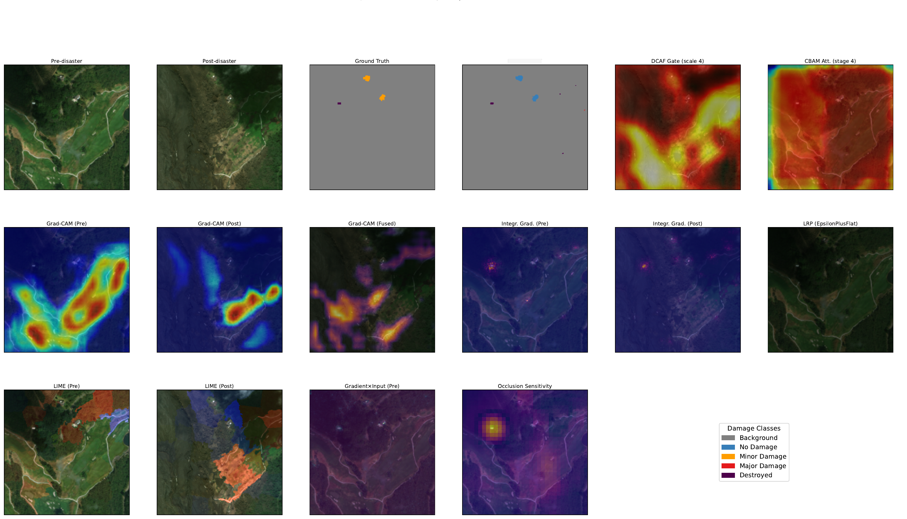

<div align="center">

# 🛰️ MS-DCAFNet

### Multi-Scale Damage-Conditioned Adaptive Fusion Network for Building Damage Assessment from Bi-Temporal Satellite Imagery


*Siamese deep learning for pixel-level, five-class building damage classification from pre- and post-disaster satellite image pairs, with a full explainability pipeline.*

</div>

> Developed during a summer research internship at the **FACTS-H Lab, IIIT Kottayam** (May 15 – July 15, 2026) under the guidance of **Dr. Ansith S**.

> 🚧 **Code status:** The source code and trained weights are not publicly released at this time. This repository currently contains the project documentation, results, figures and the full internship report.

---

## 📌 Overview

Rapid Building Damage Assessment (BDA) from satellite imagery is critical for disaster response. Two problems persist in existing approaches:

1. **Downsampling discards structure.** Max-pooling and strided convolutions throw away high-frequency information such as building edges and roof geometry.
2. **Temporal fusion is too simple.** Subtraction, differencing and concatenation struggle to capture multi-scale structural change between pre- and post-disaster images.

**MS-DCAFNet** addresses both with:

| Component | What it does |
|---|---|
| **Wavelet-Guided Multi-Scale Siamese Encoder** | Weight-shared encoder using *learnable Haar wavelet downsampling* (LL/LH/HL/HH sub-bands, softmax-weighted, with a residual LL path) plus CBAM at every stage |
| **H-DCAF** (Hierarchical Damage-Conditioned Attention Fusion) | Fuses pre-/post-disaster features at **all four encoder scales** using a change-query, a change-gated spatial mask and soft temporal gating, then aggregates scales with a learned, change-driven Scale-Weight MLP |
| **UNet++-style decoder** | Uses H-DCAF fused features as skip connections; deep supervision with two auxiliary heads (training only) |
| **Composite loss** | `0.4·Focal + 0.4·Dice + 0.2·Contrastive Boundary Loss`, applied to the main head and two auxiliary heads (weights 1.0 / 0.3 / 0.1) |
| **XAI pipeline** | Native attention, Grad-CAM, Integrated Gradients, Gradient×Input, Occlusion, LIME, LRP, CRP, with faithfulness evaluation |

<p align="center">
  
</p>

---

## 🏗️ Architecture

```
Pre-image ─┐                                   ┌─ DCAF @ scale 1 ─ f1 ─┐
           ├─► Shared WGMS Encoder (4 stages) ─┼─ DCAF @ scale 2 ─ f2 ─┼─► UNet++ Decoder ─► Main head (5 classes)
Post-image ┘   Haar downsampling + CBAM        ├─ DCAF @ scale 3 ─ f3 ─┘        │              Aux heads (train only)
                channels [64,128,256,512]      └─ DCAF @ scale 4 ─► Scale-Weight MLP ─► fused bottleneck
```

**DCAF module (per scale):** absolute-difference change map → global change query (bottleneck MLP, ratio 8) → change-gated spatial mask (1×1 → 3×3 conv, sigmoid) → softmax-normalised temporal blending of pre/post → 3×3 conv output.

---

## 📊 Dataset

Trained and evaluated on **[xBD](https://arxiv.org/abs/1911.09296)**: co-registered pre/post RGB pairs with polygon-level damage labels (No Damage, Minor, Major, Destroyed).

- Polygons rasterised to masks; all images resized to **256 × 256** (bilinear for images, nearest-neighbour for masks)
- ImageNet normalisation
- **Event-based partitioning:** the official training set (2,799 triplets) is split by *disaster event*, giving 2,573 training samples (9 events) and 226 validation samples from one held-out event. This avoids spatial leakage between adjacent tiles of the same event.
- The official held-out test set (933 triplets) is used only for final evaluation.

**Augmentation:** synchronised H/V flips (p=0.5), class-conditioned 90°×k rotation for minority-damage patches (p=0.7), CutMix on batches with Minor/Major pixels (p=0.5).

> xBD must be downloaded separately from the [official source](https://xview2.org/) and is not included in this repository.

---

## ⚙️ Training Setup

| Setting | Value |
|---|---|
| Epochs | up to 120, early stopping (patience 30) on validation F1<sub>damaged</sub> |
| Optimizer | AdamW, weight decay 1e-4 |
| LR schedule | 5-epoch linear warm-up → cosine annealing, peak 3e-4, min 1e-6 |
| Gradient clipping | 1.0 |
| Input size / batch | 256 × 256 / 16 |
| Best checkpoint | Epoch 76 (stopped at epoch 106) |
| Seed | fixed for reproducibility |

---

## 📈 Results

### Test set (official xBD held-out, 933 samples)

| Metric | Value |
|---|---|
| **F1<sub>damaged</sub>** (primary: macro F1 over Minor/Major/Destroyed) | **0.3983** |
| F1<sub>macro</sub> (all 5 classes) | 0.5716 |
| F1<sub>fg</sub> (foreground only) | 0.4716 |
| mIoU (all 5 classes) | 0.4459 |
| Overall Accuracy | 0.9403 |
| Cohen's κ | 0.6117 |

Overall accuracy is inflated by background dominance, so F1<sub>damaged</sub> is the metric used for model comparison.

### Per-class (test)

| Class | F1 | Precision | Recall | IoU |
|---|---|---|---|---|
| Background | 0.9716 | 0.9965 | 0.9479 | 0.9448 |
| No Damage | 0.6917 | 0.5884 | 0.8390 | 0.5287 |
| Minor Damage | 0.2811 | 0.1773 | 0.6790 | 0.1636 |
| Major Damage | 0.4404 | 0.3041 | 0.7983 | 0.2824 |
| Destroyed | 0.4733 | 0.3428 | 0.7640 | 0.3100 |

Recall is high and precision lower across damage classes, reflecting class-weighted training that favours avoiding missed damage. **Minor Damage** is the hardest class.

### Ablation: temporal fusion strategy (validation F1<sub>damaged</sub>)

Same encoder, decoder, loss and schedule; only the fusion differs.

| Fusion strategy | F1<sub>damaged</sub> | Δ vs. ours |
|---|---|---|
| Subtraction (bottleneck) | 0.1687 | −0.0338 |
| Concatenation (bottleneck) | 0.1785 | −0.0240 |
| Single-scale DCAF (bottleneck) | 0.1715 | −0.0310 |
| **H-DCAF ×4 (ours)** | **0.2025** | — |

### Training dynamics

<p align="center">
  
</p>

---

## 🔍 Explainability

The trained, frozen model is analysed with four complementary families of methods plus quantitative faithfulness checks:

<p align="center">
  
</p>

| Family | Methods |
|---|---|
| Native attention (no gradients) | CBAM spatial maps, DCAF gate masks, H-DCAF scale weights, Haar band weights |
| Gradient-based | Bi-temporal Grad-CAM, Gradient×Input, Integrated Gradients (Captum, zero baseline, 10 steps) |
| Perturbation-based | Occlusion sensitivity (3×32×32 patches), LIME (50 SLIC superpixels, 100 samples) |
| Relevance propagation | LRP (Zennit, EpsilonPlusFlat), CRP at the H-DCAF bottleneck |
| Faithfulness | Deletion/Insertion AUC, Pointing Game, Pearson correlation with ground truth |

**Observations**
- Learned Haar weights favour the horizontal/vertical edge sub-bands (LH, HL) over LL.
- Fused-bottleneck Grad-CAM is more spatially focused than either single-branch map.
- Grad-CAM, IG and LRP localise broadly to annotated building footprints.
- Pointing Game (Gradient×Input): macro 0.57 (Minor 0.40, Major 0.74). The H-DCAF gate scores 0.07, consistent with it being a class-independent change gate rather than a class-discriminative localiser.

### Visual results

**Native attention** (H-DCAF scale weights, CBAM, DCAF gates, Haar band weights)
<p align="center"></p>

**Grad-CAM** (pre-disaster, post-disaster, fused bottleneck, ground truth)
<p align="center"></p>

**Integrated Gradients**
<p align="center"></p>

**LRP (EpsilonPlusFlat)**
<p align="center"></p>

**Master XAI panel (Destroyed class)**
<p align="center"></p>

---

## 🗂️ Planned Repository Structure

```
ms-dcafnet/
├── configs/
│   └── default.yaml           # hyperparameters
├── data/                      # (git-ignored) xBD goes here
│   ├── raw/
│   └── processed/
├── src/
│   ├── data/                  # dataset, rasterisation, event-based split, augmentation
│   ├── models/
│   │   ├── haar_downsample.py # learnable Haar wavelet downsampling
│   │   ├── cbam.py
│   │   ├── encoder.py         # WGMSEncoder4
│   │   ├── dcaf.py            # DCAF + H-DCAF + Scale-Weight MLP
│   │   ├── decoder.py         # UNet++-style decoder + aux heads
│   │   └── ms_dcafnet.py
│   ├── losses.py              # Focal + Dice + CBL (+ deep supervision)
│   ├── train.py
│   ├── evaluate.py
│   └── xai/                   # Grad-CAM, IG, LRP, CRP, LIME, occlusion, faithfulness
├── checkpoints/               # (git-ignored)
├── assets/                    # figures used in this README
├── report/
│   └── report.pdf             # internship report
├── requirements.txt
├── LICENSE
└── README.md
```

---

## 🚀 Getting Started (when code is released)

```bash
git clone https://github.com/hiba-castellan/ms-dcafnet.git
cd ms-dcafnet
pip install -r requirements.txt
```

**Train**
```bash
python src/train.py --config configs/default.yaml
```

**Evaluate on the xBD test set**
```bash
python src/evaluate.py --checkpoint checkpoints/best.pt
```

**Run explainability analysis**
```bash
python src/xai/run_xai.py --checkpoint checkpoints/best.pt --sample <path>
```

> Update the commands above to match your actual script names and arguments.

---

## ⚠️ Limitations & Future Work

- All experiments use **256 × 256** inputs; stronger published methods often use 512 px or more, which likely hurts Minor Damage in particular.
- Event-based splits differ between papers, so direct numerical comparison with other methods is limited.
- Planned: higher resolutions (512+), evaluation on a standardised public event-based benchmark split, and targeted improvements for Minor Damage (augmentation, resolution-aware design, auxiliary supervision).
- Deployment concerns (real-time inference, operational integration) are out of scope.

---

## 📚 Key References

1. Gupta et al., *xBD: A dataset for assessing building damage from satellite imagery*, arXiv:1911.09296, 2019.
2. Woo et al., *CBAM: Convolutional Block Attention Module*, ECCV 2018.
3. Zheng et al., *Building damage assessment ... deep object-based semantic change detection* (ChangeOS), RSE 2021.
4. Williams & Li, *Wavelet pooling for convolutional neural networks*, ICLR 2018.
5. Selvaraju et al., *Grad-CAM*, ICCV 2017.
6. Sundararajan et al., *Axiomatic attribution for deep networks*, ICML 2017.
7. Bach et al., *Layer-wise relevance propagation*, PLOS ONE 2015.
8. Achtibat et al., *Concept Relevance Propagation*, Nature Machine Intelligence 2023.

Full bibliography is in [`report/report.pdf`](report/report.pdf).

---

## 📝 Citation

The associated manuscript is in preparation. Until then, please cite the report:

```bibtex
@misc{hiba2026msdcafnet,
  author = {Hiba V S},
  title  = {MS-DCAFNet: Multi-Scale Damage-Conditioned Adaptive Fusion Network
            for Building Damage Assessment from Bi-Temporal Satellite Imagery},
  year   = {2026},
  note   = {Internship report, FACTS-H Lab, IIIT Kottayam}
}
```

---

## 🙏 Acknowledgements

Supervised by **Dr. Ansith S**, FACTS-H Lab, Indian Institute of Information Technology Kottayam. Thanks to the creators of the xBD dataset.

## 👤 Author

**Hiba V S** · Data Scientist | ML Enthusiast
📧 hibasareef@gmail.com · 🔗 [GitHub](https://github.com/hiba-castellan)

## 📄 License

**All Rights Reserved.** This code, model and report may not be used, copied, modified or distributed without written permission from the author. See [LICENSE](LICENSE). For permission requests, email hibasareef@gmail.com.
